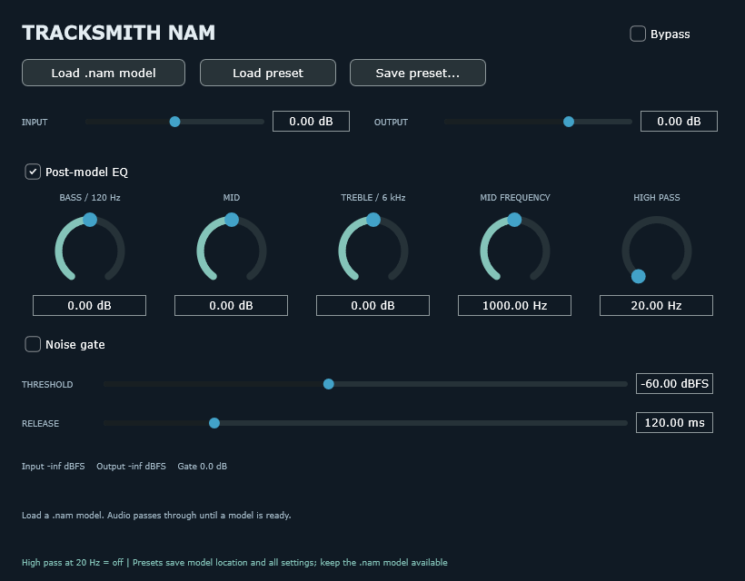
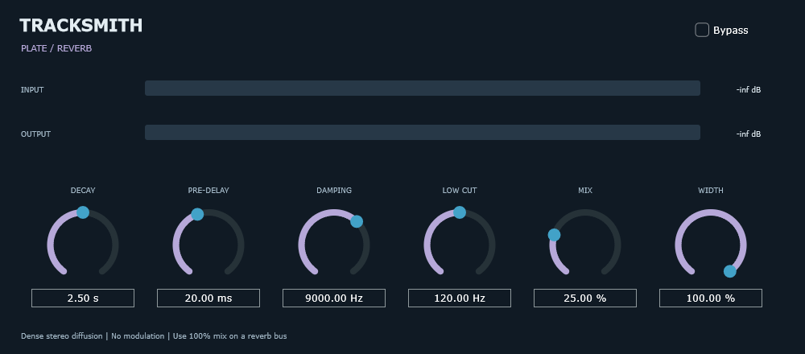
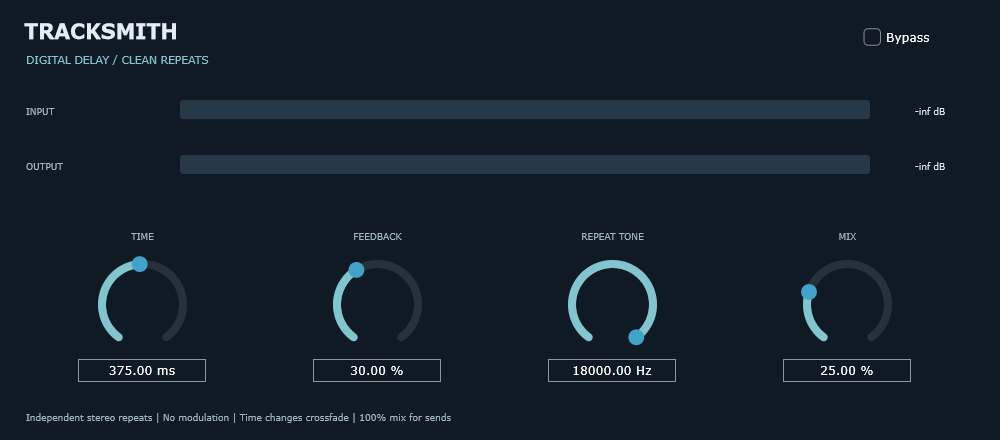

# Tracksmith - Build 25

Build 25 is the current local recording reliability build, based on the published Build 24 main checkpoint. Repeated Stop now preserves the first capture endpoint during latency drain. Current editable application source is in `Tracksmith/`; Prototype 16 and older downloads below are historical snapshots.

Includes traditional DAW menus, R/T zoom, clip editing and fades, Time Warp, instrument-track piano rolls, MIDI groove file drops, audio/MIDI clipboard shortcuts, aligned mixer controls, GGD/Kontakt output inputs and the recording Stop fix. No Library sidebar.

[Build 25 notes](BUILD25-RECORDING.md) | [Build 25 validation](BUILD25-VALIDATION.txt) | [Build 24 release notes](BUILD24-RELEASE.md) | [Current status](PROJECT-STATUS.md) | [GGD routing](BUILD22-ROUTING.md) | [Stop fix](BUILD23-STOP-FIX.md)

Session format is 12. Save a new filename when comparing with older builds. Portable executables and large runtime assets remain local; no new installer or executable download is published by this source update.

Build 16 is preserved in Git history, `prototype-16/` and the `build-16-checkpoint` tag. Main advances without rewriting earlier commits.

## Historical stock-plugin checkpoint

Development reference for Tracksmith DAW and the separate optional Tracksmith Groove VST3. Updated October 15, 2026.

## Current build: stock plugin test suite

[Download the Windows DAW test build](Tracksmith-Windows-Stock-Plugins-Test.zip) · [Current source snapshot](Tracksmith-Source-Stock-Plugins.zip) · [Plugin-only VST3 bundle](Tracksmith-Stock-Plugins-VST3.zip)

Extract the whole Windows ZIP, close the other Tracksmith, and run Tracksmith.exe from the extracted folder. Keep Stock Plugins beside the application. Choose **Add stock Tracksmith ...** from a track/aux/master insert menu. This is a portable test build, not an installer update.

The build includes nine stock VST3 plugins:

| Plugin | Current features |
| --- | --- |
| Tracksmith EQ 7 | Seven-band EQ with response graph, filters, shelves and bells |
| Tracksmith Gate | Threshold, attack, hold, release, range and hysteresis |
| Tracksmith Bus Compressor | Compression, Auto release, makeup, detector high pass and parallel mix |
| Tracksmith FET Compressor | Input-driven fast compression, four ratios and custom Slam mode |
| Tracksmith Limiter | Sample-peak ceiling, input drive and release |
| Tracksmith De-Esser | Selective-band reduction, adaptive threshold and band listen |
| Tracksmith Plate | Plate-style reverb with decay, pre-delay, damping, low cut and stereo width |
| Tracksmith Digital Delay | Clean stereo repeats, feedback and repeat tone; no modulation |
| Tracksmith NAM | Renamed AVRX NAM, with post-model EQ and preset save/load |

[Build guide and current limits](Tracksmith-Stock-Plugins-Guide.md) · [Automated results](Tracksmith-Stock-Plugin-Test-Results.json) · [Dynamics development notes](Tracksmith-Dynamics-Test-Update.md) · [Current status and next steps](PROJECT-STATUS.md)

NAM presets store the model location and settings; keep the .nam model available. Old AVRX NAM identity and original parameter IDs are preserved. The DAW redirects old AVRX NAM session entries to the renamed bundled plugin.

Automated processing, VST3 loading/state, editor rendering and existing DAW regression checks passed. Listening and real-session checks of this latest combined build are pending. The compressors are original behavioral designs, not verified analog models. The limiter is sample-peak, not true-peak.

## Preview

## Earlier milestones

The user confirmed the GGD MIDI fix works. [GGD guide](Tracksmith-GGD-MIDI-Fix-Guide.md) · [First synthetic reliability report](Tracksmith-Reliability-Report.md) · [Reliability raw results](Tracksmith-Reliability-Results.zip)

The first Windows installer trial also went well according to the user. [Earlier 0.1.0 installer](Tracksmith-Setup-0.1.0-x64.msi) · [Installer guide](Tracksmith-Installer-Guide.md) · [Installer validation](Tracksmith-Installer-Validation.md). That earlier installer predates the stock-plugin suite; use the portable ZIP above for current plugins. Longer hardware/interface testing remains before reliability is considered complete.

## Core workflow guides

- [MIDI selection, track deletion and shortcuts](Tracksmith-Selection-Shortcuts-Guide.md)
- [Instrument tracks and inline piano roll](Tracksmith-Instrument-Piano-Roll-Guide.md)
- [Playlist management and group edits](Tracksmith-Playlist-Group-Editing-Guide.md)
- [Monitoring, routing and hardware cues](Tracksmith-Monitoring-Routing-Guide.md)
- [Plugin automation](Tracksmith-Plugin-Automation-Guide.md)
- [Recording](Tracksmith-Recording-Guide.md)
- [Build history](BUILD-HISTORY.md)
- [Working away from your PC](WORKING-AWAY-FROM-PC.md)

Session format 9 reads versions 1–9. Keep session copies when testing. Plugins run in-process. Plugin scanning improvements and the main DAW custom UI remain deferred.

## Groove and preserved work

Tracksmith Groove 0.18 remains a separate optional instrument: [release downloads](https://github.com/guitarshreadr260/tracksmith/releases/tag/groove-v0.18.0) · [source snapshot](Tracksmith-Groove-Source-Code-v0.18.zip). Original AVRX Groove 0.17 is preserved locally. AVRX Drums stays excluded from the DAW package.

Current editable source is in `Tracksmith/`. Historical ZIP snapshots, builds, guides and progress notes remain preserved. Third-party licenses still apply. GitHub is updated when requested; it does not automatically mirror the PC or chat.
